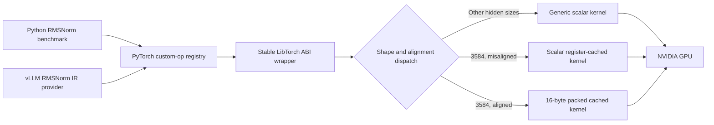
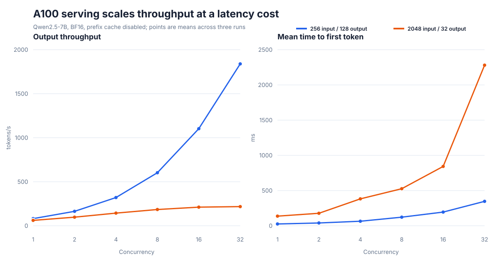

# Inference Performance Lab

[](https://github.com/sreeganeshji/inference-performance-lab/actions/workflows/quality.yml)


[](LICENSE)

An independent CUDA and inference performance project by [Ganesh Bangalore](https://github.com/sreeganeshji).
It follows Qwen2.5-7B served by vLLM on an A100 through two CUDA kernels, each tested against a trusted reference,
integrated into vLLM's serving path, and measured end to end:

1. **Paged GQA decode attention**: a tensor-core kernel served as a vLLM attention backend
   ([design and profiling report](docs/decode-attention.md), [interview questions](docs/decode-attention-interview-guide.md)).
2. **Fused residual-add + RMSNorm**: from prefill/decode profiling through vLLM IR integration, and a measurement
   correction that turned its standalone speedup into parity.

The engineering question: how much does a faster CUDA primitive improve model serving? The project measures both
standalone kernel latency and serving behavior, and every claim links to raw measurements and profiler evidence.

## Results at a glance

Serving measurements use Qwen2.5-7B-Instruct in BF16 on one NVIDIA A100-SXM4-40GB with vLLM 0.33. Kernel benchmarks
use CUDA-graph replay on synthetic inputs at the model's shapes.

| Result | Measurement | Takeaway |
|---|---:|---|
| Decode attention vs vLLM's FlashAttention-2 kernel, 12 batch × context shapes | **1.03–1.48x faster, 12/12** | Peaks at 1,351 GB/s, 87% of the A100's HBM bandwidth. |
| Decode attention vs FlashInfer's tensor-core decode | faster in 9/12, up to **1.10x** | 0.94–0.96x at batch 1 with long context; the gap is the split-combine step. |
| Serving with the decode backend, 6 workloads | **1.01–1.29x** output throughput | Largest at high concurrency (4K prompts, 64 requests). |
| Attention in a mixed prefill + decode step, per layer | **1,967 → ~790 µs** | vLLM's FlashAttention backend runs decode rows without GQA packing when a prefill chunk shares the launch. |
| Greedy output against FLASH_ATTN, real weights | 334/384 tokens identical | The same as vLLM's own Triton backend; within normal BF16 divergence. |
| Scheduler CPU time exposed as GPU idle | **≈ 0 ms** per 22–60 s trace | Async scheduling hides it; a faster scheduler would not raise throughput here. |
| Fused add-RMSNorm vs vLLM, 1–2,048 rows | **0.99–1.03x** | An earlier 1.14–1.17x came from timing eager launches; see [below](#fused-residual-add-and-rmsnorm). |
| Custom RMSNorm inside vLLM serving | 6,104 launches; −0.42% to +0.04% throughput | RMSNorm is 1.5% of GPU kernel time, so even a real speedup could not show. |
| SiLU-and-multiply vs vLLM, 1 / 8 / 128 rows | **2.82x / 2.41x / 1.07x** | vLLM runs one block per row; standalone only, not integrated into serving. |
| Causal prefill attention (branch [`flash-prefill`](https://github.com/sreeganeshji/inference-performance-lab/tree/flash-prefill)) | 1.02–1.23x vs FA2 on an RTX 3080 Ti; 0.81–1.59x on the A100 | On sm_80, FA2 switches to a 128-row query tile that this kernel lacks. |

## Case study 1: paged GQA decode attention

`csrc/paged_decode_attention_kernel.cu` computes one decode step's attention over vLLM's paged KV cache for
Qwen2.5-7B (28 query heads sharing 4 KV heads, head dimension 128, BF16). It is built up in four steps: one block per
query head; one block per KV head, so each KV row is read once; split-KV with a log-sum-exp combine, for parallelism at
small batch; and `mma.sync` tensor cores, with K and V loaded straight from global memory into fragment registers and
P·V computed transposed (Oᵀ = VᵀPᵀ) so the 7-head GQA group needs no padding. The split count comes from a cost model
whose constants are fitted per GPU to measured sweeps.

The vLLM backend (`src/inference_performance_lab/kernels/vllm_attention.py`, selected with
`--attention-backend CUSTOM`) asks vLLM to put decode requests first in each batch, sends them to this kernel and the
remaining rows to FlashAttention-2, and supports full CUDA graphs.

| A100, µs | 1 × 4K | 4 × 16K | 16 × 4K | 64 × 4K | 64 × 16K |
|---|---:|---:|---:|---:|---:|
| this kernel | 20.1 | 111.6 | 110.3 | 398.0 | 1,593 |
| vLLM FlashAttention-2 | 27.2 | 123.9 | 122.6 | 505.8 | 1,973 |
| FlashInfer tensor-core decode | 19.3 | 112.9 | 111.9 | 433.6 | 1,709 |

Nsight Systems traces of serving show where the end-to-end gain comes from: attention fell from 33.7% to 19.2% of GPU
kernel time at 64 concurrent requests, mostly in steps that mix a prefill chunk with decodes. Nsight Compute shows why
the kernel wins at batch 64: at 142 registers it keeps 3 blocks per SM, so 256 blocks finish in one partial wave at
87% of DRAM bandwidth, while FA2's kernel needs 1.19 waves and averages 63%. The
[report](docs/decode-attention.md) has the full grid, the serving A/B, the profiles, correctness checks and
limitations.

## Case study 2: fused residual-add and RMSNorm



The baseline trace showed that BF16 GEMMs occupied roughly 87–89% of aggregate GPU kernel time and were already using
optimized Ampere tensor-core implementations. Fused RMSNorm was chosen as a bounded, memory-oriented first kernel;
fused SiLU-and-multiply followed as a larger elementwise workload.

### Fused residual-add and RMSNorm

- One block per token row and 256 threads per block.
- FP32 accumulation with warp shuffles and a two-level block reduction.
- Fused residual update, RMS normalization, and BF16 output write.
- A hidden-size-3584 specialization caches fused values in registers.
- The packed path transfers eight BF16 values per 16-byte load or store.
- Contiguous, misaligned tensors at hidden size 3584 use the scalar cached kernel; other hidden sizes use the generic
  kernel. Noncontiguous tensors and unsupported dtypes are rejected.

The current tests compare both custom and vLLM implementations with a PyTorch reference at 1, 8, 128, and 2,048 rows.
Separate tests verify deliberately misaligned custom RMSNorm inputs against that reference.

**A measurement correction.** The first standalone benchmarks (`benchmarks/benchmark_fused_add_rms_norm.py`,
`benchmarks/benchmark_silu_and_mul.py`) timed a Python loop of eager launches between two CUDA events and reported
RMSNorm at 1.14–1.17x vLLM's speed. At a few rows each kernel runs for about 3 µs, so that loop measures launch
overhead as much as the kernel. `benchmarks/benchmark_elementwise_graphs.py` re-times both kernels the way vLLM runs
them, inside CUDA graphs, with interleaved trials and inputs rotated past the L2 cache
([A100](results/data/elementwise/a100-sxm4-40gb-graphs-20261107.md),
[RTX 3080 Ti](results/data/elementwise/rtx3080ti-graphs-20261107.md)):

| A100, CUDA-graph replay | 1 row | 8 rows | 128 rows | 2,048 rows |
|---|---:|---:|---:|---:|
| fused add-RMSNorm, vLLM µs / lab µs | 3.32 / 3.36 | 2.69 / 2.71 | 5.75 / 5.61 | 47.68 / 47.22 |
| ratio (vLLM / lab) | 0.99x | 0.99x | 1.03x | 1.01x |
| SiLU-and-multiply, vLLM µs / lab µs | 6.00 / 2.13 | 7.46 / 3.09 | 15.72 / 14.65 | 175.79 / 176.81 |
| ratio (vLLM / lab) | **2.82x** | **2.41x** | 1.07x | 0.99x |

The RMSNorm kernel is at parity with vLLM's; on the RTX 3080 Ti, vLLM's is about 9% faster at 8 rows. This agrees
with the serving traces, where the custom provider used 2.72% more aggregate RMSNorm GPU time. Even a real 1.15x would
have been bounded by Amdahl's law to about 0.2% of GPU kernel time, since RMSNorm occupied 1.5%. See the
[matched-provider analysis](results/a100-qwen2.5-7b-custom-rmsnorm-analysis.md); its standalone figures predate this
correction.

### Additional experiment: fused SiLU-and-multiply

- Computes the SwiGLU elementwise stage without intermediate tensors.
- Provides scalar and packed BF16 implementations behind the same custom-op library.
- Uses a two-dimensional launch: rows on `blockIdx.y`, contiguous output columns across threads on `blockIdx.x`.
  vLLM's kernel runs one block per row, so a single row of 18,944 outputs occupies one SM; spreading the columns over
  many blocks is why the packed kernel is 2.8x faster at one row and 2.4x at eight under CUDA-graph timing, falling to
  parity once there are enough rows to fill the GPU.
- The packed API requires 16-byte-aligned contiguous tensors and an output width divisible by eight; the scalar API
  is separately callable. Only RMSNorm currently has a custom vLLM IR provider. In vLLM's default compiled mode the
  serving traces show no SiLU custom op at all: Inductor generates `triton_poi_fused_mul_silu_slice_1` in its place,
  so this kernel's gain would need its own integration and serving test to mean anything.

## Serving baseline

The baseline sweep (vLLM's stock kernels, before either case study) used 32 fixed-shape requests per run, three repetitions, burst arrival, deterministic generation,
and disabled prefix caching. Throughput increased with concurrency, but prefill-heavy latency rose sharply after the
throughput knee.



For the 2,048-input/32-output workload, output throughput increased only 2.93% from concurrency 16 to 32 while mean
time to first token grew from 843 ms to 2,281 ms. This makes concurrency 16 the approximate throughput knee for that
controlled workload.

The baseline above uses 32 requests per run. The custom-versus-vLLM RMSNorm comparison uses 64 requests per run,
concurrency 1 / 8 / 32, and three repetitions for each provider. Those experiments are reported separately.

The detailed interpretation, including the matched-provider comparison and limitations, is in the
[custom RMSNorm analysis](results/a100-qwen2.5-7b-custom-rmsnorm-analysis.md). The
[results index](results/README.md) connects every headline claim to summaries and raw artifacts.

## Reproduce locally

### Prerequisites

- Linux or WSL2 with an NVIDIA GPU visible through `nvidia-smi`
- CUDA 13 toolkit with `nvcc` and a compatible C++ compiler (the extension uses C++20)
- Python 3.12 and [uv](https://docs.astral.sh/uv/)
- An Ampere-or-newer GPU for the BF16 development path

The local development path was validated on an RTX 3080 Ti (SM 8.6, 12 GiB). Published portfolio measurements remain
the controlled A100 (SM 8.0, 40 GiB) results.

Install only the dependencies required to build and test the CUDA kernels:

```bash
git clone https://github.com/sreeganeshji/inference-performance-lab.git
cd inference-performance-lab
./scripts/bootstrap.sh --kernels-only
./scripts/doctor.sh
./scripts/test_kernels.sh
```

`test_kernels.sh` lets PyTorch detect the visible GPU. To build for a specific architecture, set it explicitly:

```bash
TORCH_CUDA_ARCH_LIST=8.6 ./scripts/test_kernels.sh
```

The first kernel call compiles the extension with Ninja and NVCC, then caches it under
`.cache/torch_extensions/fused_add_rms_norm/`.

Both profiles share `.venv`. Running `bootstrap.sh --kernels-only` removes the optional serving packages; running
`bootstrap.sh` reinstalls them from the lockfile. Use `uv run --locked --no-sync` for subsequent commands to preserve
the selected profile.

### Full vLLM environment

The default profile includes the optional serving stack:

```bash
./scripts/bootstrap.sh
./scripts/doctor.sh
uv run --locked --no-sync pytest -m "gpu"
```

Run the standalone comparisons, timed with CUDA-graph replay:

```bash
uv run --locked --no-sync python benchmarks/benchmark_elementwise_graphs.py
```

The decode-attention case study has its own end-to-end script for a fresh GPU machine (it installs the driver and
CUDA 13 toolkit if missing, a separate venv with vLLM 0.33.0 and FlashInfer, then runs each step):

```bash
scripts/attention_gpu_run.sh setup
scripts/attention_gpu_run.sh test      # 125 correctness tests, including an end-to-end vLLM check
scripts/attention_gpu_run.sh kernels   # kernel grid against FlashAttention-2 and FlashInfer
scripts/attention_gpu_run.sh check     # greedy decoding on Qwen2.5-7B-Instruct, CUSTOM vs FLASH_ATTN
scripts/attention_gpu_run.sh serving   # serving A/B, about an hour on an A100
scripts/attention_gpu_run.sh profile   # Nsight Systems traces of serving
```

The serving commands reproduce the A100 experiment and download the pinned model revision. BF16 weights alone exceed
the 3080 Ti's 12 GiB, so use that GPU for kernel work and a GPU with sufficient memory for this serving experiment.
Start the baseline server in terminal 1:

```bash
./scripts/serve.sh
```

After the server is ready, run the baseline sweep in terminal 2:

```bash
./scripts/run_sweep.sh
```

To reproduce the matched-provider protocol, run this sweep against the baseline server:

```bash
NUM_PROMPTS=64 CONCURRENCIES="1 8 32" PROTOCOL=rmsnorm/vllm-c ./scripts/run_sweep.sh
```

Stop the baseline server with Ctrl+C, then start the custom RMSNorm provider in terminal 1:

```bash
FUSED_RMSNORM_PROVIDER=inference_lab ./scripts/serve.sh
```

After it is ready, run the same workload in terminal 2:

```bash
NUM_PROMPTS=64 CONCURRENCIES="1 8 32" PROTOCOL=rmsnorm/inference-lab ./scripts/run_sweep.sh
```

New runs are written under `artifacts/raw/<protocol>/`. The serving harness currently targets the fixed A100/Qwen
experiment and names files accordingly. Protocol directory separators become hyphens in filenames. To use a different
port, set the same `VLLM_PORT` value in both terminals. Historical A100 results predate the Stable ABI migration; a new run on the
current checkout is a fresh measurement, not a replacement for that evidence.

Regenerate the checked-in result summary and README charts with:

```bash
uv run --locked --no-sync python scripts/generate_readme_assets.py
```

This generator also runs without GPU dependencies: `python3 scripts/generate_readme_assets.py`.

## Repository guide

| Path | Purpose |
|---|---|
| `csrc/` | Stable-ABI PyTorch registration and CUDA kernel implementations |
| `src/inference_performance_lab/kernels/` | Python API, references, the vLLM attention backend and IR provider |
| `tests/` | PyTorch-reference correctness, alignment fallbacks, and optional vLLM comparisons |
| `benchmarks/` | Kernel benchmarks against vLLM, FlashAttention-2 and FlashInfer; serving A/B and trace analysis |
| `scripts/` | Environment setup, serving, workload sweeps, profiling setup, and result generation |
| `docs/` | The decode-attention report and interview guide; README charts |
| `results/` | Analysis, aggregate tables, raw benchmark data, and profiler evidence |

## Build and compatibility

The extension targets the PyTorch 2.13 Stable LibTorch ABI. Its host wrappers use `torch::stable::Tensor`, boxed
operator registration, header-only scalar types, stable device guards, and stable accelerator streams.
`TORCH_TARGET_VERSION=0x020d000000000000` is passed to both C++ and CUDA compilation so accidental use of newer ABI
surfaces fails during the build.

The CUDA kernels still operate on typed device pointers. Stable-ABI integration did not change their thread mapping,
memory access, reductions, launch dimensions, or numerical behavior.

The Quality workflow checks Python/C++ formatting, lint, each shell script's syntax, the lockfile, and generated
artifacts on a CPU runner. GPU correctness is checked separately with the commands above.

## Limitations and follow-up work

- Published performance measurements cover one A100, one model, BF16, and synthetic fixed-length requests.
- Three serving repetitions per cell characterize these workloads, not every deployment.
- The decode-attention kernel covers head dimension 128, GQA groups up to 8 and a BF16 KV cache; other layers fall
  back to FlashAttention-2. Its [limitations](docs/decode-attention.md#limitations) are listed with the report.
- The optimized RMSNorm specialization targets hidden size 3584; other shapes use a generic fallback.
- The RMSNorm provider runs were not interleaved, so temporal system effects may remain; the decode-attention A/B
  alternates backends between rounds.
- The original RMSNorm and SiLU microbenchmarks time eager launches from Python and run implementations in a fixed
  order. Their small-shape timings include launch overhead; `benchmark_elementwise_graphs.py` replaces them for
  comparisons, and the generated summary and chart still describe the original runs.
- A standalone CMake/raw-CUDA frontend would be useful for learning and profiler isolation, but the production path
  intentionally remains the PyTorch extension used by vLLM.
- The next system-level optimization should be selected from a fresh production trace rather than from isolated
  kernel speedup alone.

## License

Released under the [MIT License](LICENSE).
